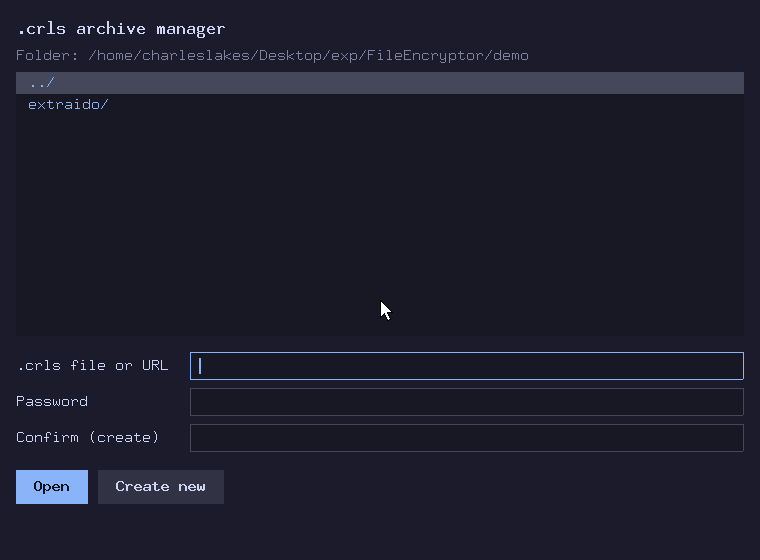

# FileEncryptor

A small desktop app, written in C++, that keeps files inside an encrypted,
password-protected archive with the `.crls` extension. Archives can also be
published over HTTP(S) and read, or added to, from anywhere that knows the
password.

- **Encryption:** Argon2id derives the key from the password. XChaCha20-Poly1305
  encrypts each file in 64 KB chunks and also encrypts the index.
- **GUI:** one window with four screens, drawn with plain Xlib on Linux and
  with Win32/GDI on Windows.
- **Remote archives:** open `https://…/file.crls` in the GUI, or serve a folder
  with `file-encryptor --server`. Files are encrypted on the client: the server
  never sees the password or the contents.
- **No `-dev` packages on Linux:** the Xlib, libsodium and libcurl declarations
  the code needs are written by hand in `src/deps/`, so you only need the
  runtime libraries.



## Build and run

### Linux

Requirements: `g++` (13 or newer), `cmake` (3.16 or newer), `libX11.so.6` and
`libsodium.so.23`. Both libraries come with most Linux desktops (on
Debian/Ubuntu they are the packages `libx11-6` and `libsodium23`). Opening
archives by URL also needs `libcurl.so.4` (`libcurl4`), which is loaded only
when it is used.

```sh
cmake -B build                 # configure (once)
cmake --build build            # builds build/file-encryptor
./build/file-encryptor         # starts the GUI
ctest --test-dir build         # tests (no display needed)
```

### Windows

Install [MSYS2](https://www.msys2.org/), open the **UCRT64** shell and run:

```sh
pacman -S --needed mingw-w64-ucrt-x86_64-gcc mingw-w64-ucrt-x86_64-cmake \
                   mingw-w64-ucrt-x86_64-ninja mingw-w64-ucrt-x86_64-libsodium
cmake -B build -G Ninja        # the Windows backend is picked automatically
cmake --build build            # builds file-encryptor.exe and file-encryptor-cli.exe
./build/file-encryptor.exe
ctest --test-dir build
```

`file-encryptor.exe` is the GUI. `file-encryptor-cli.exe` is the same program
built as a console application: use it for `--server` and `--upload`. To run
either outside the MSYS2 shell, copy `libsodium-26.dll` from
`C:\msys64\ucrt64\bin` next to it. HTTPS uses WinHTTP, which is part of
Windows.

To cross-compile from Linux with MinGW-w64, use the
[prebuilt libsodium for MinGW](https://download.libsodium.org/libsodium/releases/):

```sh
cmake -B build-win -DCMAKE_TOOLCHAIN_FILE=cmake/mingw-w64.cmake \
      -DCMAKE_LIBRARY_PATH=/path/to/libsodium-win64/lib
cmake --build build-win
```

## Using it

1. **Open screen:** pick a `.crls` file in the list or type its path (or its
   `http://` / `https://` URL), then type the password and press **Open**. To
   make a new archive, type a name, fill in both password fields (at least 8
   characters) and press **Create new**.
2. **Archive screen:** **Add** and **Extract** open a folder browser.
   **Delete** must be pressed twice to confirm. Deleted data stays in the file as
   unused space until you press **Compact**. On a remote archive, **Add**
   uploads the file, and Delete and Compact are not available.
3. Keys: arrow keys, PgUp/PgDn and Home/End move the selection. Enter runs the
   selected item, Esc cancels, Backspace goes up one folder, Tab switches
   between fields, Delete removes the selected file.

Extraction never overwrites anything: a file that already exists in the target
folder is skipped.

## Sharing archives over HTTP

### Serving a folder

```sh
file-encryptor --server ~/vaults                       # http://127.0.0.1:8080/
file-encryptor --server ~/vaults --bind 0.0.0.0 --port 9000 --max-upload 2147483648
```

| Request             | What it does                                           |
|---------------------|--------------------------------------------------------|
| `GET /`             | Names of the `.crls` files, one per line               |
| `GET /name.crls`    | The encrypted archive as it is (Range requests work)   |
| `POST /name.crls`   | Signed upload of a new file (see below)                |

The server never needs a password: anyone can download the encrypted bytes
(for example with `curl -O http://host:8080/name.crls`), but only someone with
the password can read them or add files. The server does not create new
archives: create one locally and copy it into the folder. It refuses uploads
while the archive is open in the GUI on the same machine, and uploads need an
archive in format version 3 (compact older archives once).

The server speaks plain HTTP and listens on `127.0.0.1` by default. To publish
it, put a reverse proxy with HTTPS in front of it, for example Caddy:

```
vault.example.com {
    reverse_proxy 127.0.0.1:8080
}
```

With nginx, disable request buffering and allow large bodies so uploads stream
through: `proxy_request_buffering off; client_max_body_size 2g;`, and do not
compress `application/octet-stream` (compression breaks byte ranges).

### Reading and uploading

- **GUI:** type the URL in the path field and open it as usual.
- **Command line:** `file-encryptor --upload https://vault.example.com/name.crls file1 file2`
  asks for the password without echoing it (or reads it as one line from
  standard input, for scripts).
- Reading works from any HTTP server that supports Range requests (nginx,
  Apache, object storage…); uploading needs `file-encryptor --server`.

With the wrong password nothing is shown and nothing can be uploaded. Only the
new file and the new index are sent; existing files are never sent again.

## Repository layout

```
CMakeLists.txt        build: core library, server, CLI, program and tests
docs/
  demo.gif            the animation above
  record_demo.py      records demo.gif by driving the GUI (X11, wmctrl, xwd, Pillow)
cmake/
  mingw-w64.cmake     toolchain file to cross-compile for Windows
src/
  main.cpp            entry point: GUI, or --server / --upload
  core/               program logic, no UI code
    archive.h/.cpp    the .crls format: open, create, add, extract, delete, compact
    source.h/.cpp     where archive bytes are read from (a local file or a URL)
    append.h/.cpp     signed uploads: built by the client, checked by the server
    remote.h/.cpp     archives at http(s) URLs: Range reads with a cache, uploads
    browser.h/.cpp    list of one folder's contents (filtered and sorted)
    httpmsg.h/.cpp    strict HTTP/1.1 parsing (requests, ranges, hex)
    status.h/.cpp     the status line message (set_status)
    util.h/.cpp       little-endian ints, sizes, paths
    fs.h              files and paths: everything that differs between systems
    fs_posix.cpp      ... for Linux (pread, flock, realpath, rename)
    fs_win32.cpp      ... for Windows (ReadFile, LockFileEx, MoveFileEx)
    net.h             TCP sockets
    net_posix.cpp     ... BSD sockets
    net_win32.cpp     ... Winsock
    http.h            HTTP(S) requests
    http_curl.cpp     ... libcurl, loaded with dlopen()
    http_winhttp.cpp  ... WinHTTP
  server/
    server.h/.cpp     the --server mode
  cli/
    cli.h/.cpp        the --upload mode
    tty.h             password prompt without echo
    tty_posix.cpp     ... termios
    tty_win32.cpp     ... console mode
  ui/                 GUI
    ui.h              app_state, constants, all UI prototypes
    platform.h        window, events, drawing and fonts, independent of the OS
    platform_x11.cpp  ... implemented with Xlib
    platform_win32.cpp ... implemented with Win32/GDI
    layout.cpp        app state, list geometry, which buttons each screen has
    draw.cpp          painting of each screen
    actions.cpp       what each button / Enter does
    input.cpp         mouse and keyboard to actions
  deps/               hand-written declarations of external libraries
    xlib.h            used only by platform_x11.cpp
    sodium.h
    curl.h            used only by http_curl.cpp
  lib/                basic C++ types, header only
    unique_fd.h       file descriptor closed on destruction
    secret.h          fixed buffers for keys and passwords, wiped on destruction
    heap_buffer.h     large allocations that fail without aborting
    function_ref.h    non-owning callback parameter
tests/
  test_util.h/.cpp    CHECK(), CHECK_EQ(), temp_dir, files with known contents
  server_fixture.h/.cpp test_server: the server in a thread for the tests
  test_archive.cpp    the .crls format, versions 2 and 3
  test_append.cpp     signed uploads without a network
  test_httpmsg.cpp    the HTTP parser, including malformed requests
  test_server.cpp     the server over real sockets
  test_remote.cpp     URL reading and uploading against the server (needs libcurl)
  test_cli.cpp        --upload (needs libcurl)
  test_lib.cpp        the types in src/lib/
  fixtures/v2.crls    archive written by the version 2 format (compatibility test)
```

Dependencies only go downward: `main → ui / server / cli → core → lib/deps`.
Nothing in `core/` includes `ui/`, `server/` or `cli/`, so the core can be tested
without a display.

CMake picks the `*_posix.cpp` / `*_x11.cpp` / `http_curl.cpp` files or the
`*_win32.cpp` / `http_winhttp.cpp` files from the target system (`WIN32` or not).
No other file contains operating system specific code, except for a few
`#ifdef _WIN32` lines in the tests.

## How it works

### One event, start to finish

```
platform event ──► input.cpp ──► actions.cpp ──► core/archive.cpp ──► set_status()
  (main.cpp)         (click/key)  (handle_action)  (does the work)     │
                                                                     ▼
                                            draw.cpp repaints the whole window
```

All UI state lives in one `app_state` object (`ui/ui.h`), created in `main()`
and passed by reference to every UI function. The current screen is
`app.screen`. Functions that can fail return `false` (or
an error value such as `extract_result::failed`) after they have already set an
error message with `set_status()`, so the caller only checks the return value.
The open archive is a `crls::archive` object that owns its file and its keys,
which are wiped when it is closed.

### The `.crls` file format

See the comment at the top of `src/core/archive.h` for the byte-level layout.
In short:

```
[96 byte header][file 1 chunks][file 2 chunks]...[index][file 3 chunks][index]...
                                                          ▲ header points to the latest index
```

- The header holds the Argon2id parameters, the salt, the public key that
  authorizes uploads and the position of the current index.
- Two keys are derived from the password: one encrypts, the other signs
  uploads (Ed25519). Only the public half of the second is stored.
- Each file is a separate secretstream, so a truncated or reordered file fails
  to decrypt.
- The index (names, sizes, offsets) is encrypted and authenticated together
  with the header.
- Add and Delete append a **new** index and then update the header pointer. If
  the program stops halfway, the previous index still works.
- **Compact** copies the live encrypted chunks into `<name>.tmp` without
  decrypting them, writes a fresh index and renames the temp file over the
  original. Compacting a version 2 archive (64 byte header, no upload key)
  re-encrypts it into version 3.

Every `.crls` file starts with the magic bytes `CRLS` followed by two zero
bytes.

### Remote archives and uploads

A remote archive is read through `Range` requests: opening downloads the header
and the index, extracting a file downloads only that file. Every request sends
`If-Match` with the archive's ETag, so a client notices when the archive was
replaced (compacted) on the server.

An upload is built entirely on the client (`core/append.h`): it encrypts the
file, builds the new index and signs a message that covers the current index
(through its random nonce), the lengths and a BLAKE2b hash of the body. The
server checks the signature with the public key from the header **before**
reading the body, appends the body, checks its hash and only then moves the
index pointer; any failure truncates the file back. If another client uploaded
first, the server answers 409 and the client rebuilds only the index on top of
the new state and tries again.

## Contributing (humans and LLMs)

- **Where things go:** format or crypto changes go in `core/archive.cpp`; the
  upload protocol in `core/append.cpp` (both sides) and `server/server.cpp`. A new
  button means a `ui_action` value in `ui/ui.h`, an entry in `get_buttons()`
  (`layout.cpp`) and a `case` in `handle_action()` (`actions.cpp`). Painting goes
  in `draw.cpp`.
- **Using a new libsodium, Xlib or libcurl function:** declare it in
  `src/deps/`, inside the `extern "C"` block, with the exact signature from the
  real header. libcurl options must go through the typed wrappers in
  `http_curl.cpp`.
- **Operating system specific code:** files and paths go in `core/fs.h`,
  sockets in `core/net.h`, HTTP clients in `core/http.h`, password prompts in
  `cli/tty.h` and windowing in `ui/platform.h`, each with one implementation
  per system. Always add `O_BINARY` to `open()` flags, and use `fs_basename()`
  / `fs_is_separator()` / `fs_is_absolute()` instead of looking for `'/'`.
- **Network input is hostile:** anything read from a socket or an HTTP
  response goes through the strict parsers in `core/httpmsg.cpp`, and every
  length is checked before it is used. Add a case to `tests/test_httpmsg.cpp`
  when you accept something new.
- **Style:** C++20 built with `-fno-exceptions -fno-rtti`: functions report
  errors by returning `false` (or an error value) after `set_status()`, never by
  throwing. Everything lives in `namespace crls` (tests and `main.cpp` use
  `using namespace crls;`). Two-space indentation, `snake_case`, `static` for
  anything private to a file. Every file starts with a Doxygen block (`@file`, `@brief`,
  `@author`, `Maintainer:`) and public functions are documented in their
  header with `@brief`, `@param` and `@return`, following `src/lib/heap_buffer.h`.
  All code, comments and UI text are in English.
- **Secrets:** keep passwords and keys in `crls::secret` / `secret_text`
  (`lib/secret.h`) and decrypted data in `secret_buffer`, which are wiped when
  destroyed; never put them in `std::string` or a growing `std::vector`, which
  can leave copies behind. Wipe anything else with `sodium_memzero()`.
- **C++ conventions:**
  - **Errors:** no exceptions and no RTTI. A function that can fail returns
    `false`, `std::nullopt` or an `enum class` error value after calling
    `set_status()`, and is marked `[[nodiscard]]`.
  - **Allocations:** a failed `std::vector` or `std::string` allocation ends
    the program, which is fine for small sizes. A size that comes from a file
    or the network goes through `crls::heap_buffer::allocate()`, which can
    fail and be reported.
  - **Ownership:** resources have an owner that releases them: `unique_fd`,
    `unique_socket`, `std::unique_ptr` with a deleter for library handles, and
    the `archive` and `append_upload` classes.
  - **Callbacks:** callback parameters are `crls::function_ref`. Never pass a
    `std::string` or another class through `...` (`set_status()`,
    `curl_easy_setopt()`); `set_status()` is format-checked by the compiler.
  - **Types:** `enum class` instead of plain enums; `inline constexpr`
    constants instead of `#define` (the format constants keep their
    upper-case names); `std::span` and `std::string_view` for buffers and text
    that are only read.
- **Editor setup:** clangd (LunarVim, VS Code, etc.) reads
  `build/compile_commands.json`, which CMake writes on every configure, to find
  the `src/` include path and flags.
- **Before committing:** `cmake --build build && ctest --test-dir build` must
  finish with no warnings and no failed tests. If you change the format, add a
  test in `tests/test_archive.cpp`; never regenerate `tests/fixtures/v2.crls`.
- **Commit messages:** follow
  [Conventional Commits 1.0.0](https://www.conventionalcommits.org/en/v1.0.0/):
  `<type>[optional scope]: <description>`, e.g. `feat(ui): add Windows backend`
  or `fix(core): reject backslashes in stored names`. Common types are `feat`,
  `fix`, `docs`, `refactor`, `test`, `build` and `chore`; a breaking change adds
  `!` before the colon.
  - Write only the title line, with no body.
  - `Co-authored-by` lines for AI tools are **forbidden**. When an AI assistant
    helped, add a single `Assisted-by` trailer after a blank line, as described
    in the
    [Linux kernel guidelines](https://docs.kernel.org/process/coding-assistants.html):
    `Assisted-by: LLM [TOOL1] [TOOL2]`, where the tools are optional
    specialized analysis tools (not git, gcc, make or editors).
